# AWS VPC Peering Project — Step-by-Step Implementation and Evidence

**Author:** Abdul Aziz  
**Program:** EWB AWS Cloud Computing Internship — Batch 1  
**AWS Region:** Asia Pacific (Mumbai), `ap-south-1`  
**Submission date:** 27 October 2026  
**Project type:** Educational AWS networking lab  
**Environment status:** Historical lab; resources were reported as cleaned up after testing

> **About this repository:** This repository documents the design, configuration, connectivity tests, evidence, and reported cleanup for a lab that connects two non-overlapping Amazon Virtual Private Clouds (VPCs) using VPC peering. It includes the architecture diagrams, the supplied console/terminal screenshots, resource inventories, troubleshooting notes, and the project report PDF. The screenshots are evidence of the state visible when they were captured; they do not prove that the environment still exists today.

## Table of contents

- [1. Project overview](#1-project-overview)
- [2. Goals and learning outcomes](#2-goals-and-learning-outcomes)
- [3. Architecture](#3-architecture)
- [4. IP addressing plan](#4-ip-addressing-plan)
- [5. How the network works](#5-how-the-network-works)
- [6. Step-by-step implementation](#6-step-by-step-implementation)
- [7. Route-table design](#7-route-table-design)
- [8. Security-group design](#8-security-group-design)
- [9. Connectivity testing and results](#9-connectivity-testing-and-results)
- [10. Screenshot evidence gallery](#10-screenshot-evidence-gallery)
- [11. Troubleshooting and lessons learned](#11-troubleshooting-and-lessons-learned)
- [12. Cleanup and cost-safety notes](#12-cleanup-and-cost-safety-notes)
- [13. Repository guide](#13-repository-guide)
- [14. Limitations and evidence quality](#14-limitations-and-evidence-quality)
- [15. Security notes](#15-security-notes)

## 1. Project overview

The objective was to connect two separate VPCs in AWS so that private workloads in each VPC could communicate over private IPv4 addresses. VPC A contains a public subnet for an administrative bastion host and a private subnet for App-A. VPC B contains a private subnet for App-B. A VPC peering connection links the two VPCs, and route tables on both sides direct traffic for the peer CIDR through that connection.

The two VPCs use different, non-overlapping IPv4 ranges:

- **VPC A:** `10.10.0.0/16`
- **VPC B:** `10.20.0.0/16`

The application instances were designed to remain private: App-A uses `10.10.2.10` and App-B uses `10.20.1.10`; neither was shown with a public IPv4 address in the supplied EC2 screenshots. Administration is performed by connecting to the bastion first, then connecting from the bastion to the private instances.

### Why use VPC peering?

VPC peering provides private network connectivity between two VPCs using AWS networking infrastructure. It does not automatically add routes to route tables: each relevant route table must contain a route to the other VPC's CIDR, with the peering connection as the target. Security groups must also permit the intended traffic. A peering connection can be Active while communication still fails if routes, security rules, or host settings are incorrect.

## 2. Goals and learning outcomes

This lab demonstrates the following networking concepts:

1. Creating VPCs with separate, non-overlapping address ranges.
2. Dividing VPCs into public and private subnets.
3. Attaching an Internet Gateway to a VPC and using a public route for the bastion.
4. Creating and accepting a VPC peering connection.
5. Configuring forward and return routes for private cross-VPC traffic.
6. Using security groups to limit SSH and ICMP traffic to intended sources.
7. Connecting to private EC2 instances through a bastion host.
8. Testing connectivity and deliberately observing a security-rule-related failure.
9. Keeping an evidence trail and recording what is demonstrated versus what is only reported.
10. Recording cleanup actions and checking for remaining chargeable resources.

## 3. Architecture

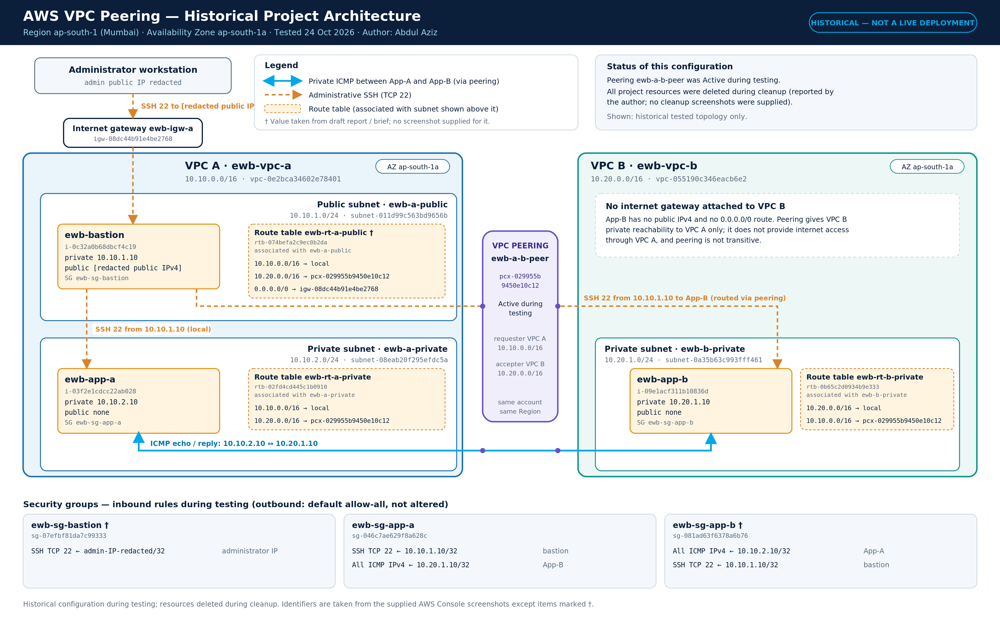

**Architecture diagram:** The diagram represents the intended lab layout: VPC A has a public bastion subnet and a private application subnet; VPC B has a private application subnet; and the VPCs communicate through a peering connection.

Alternative and supporting diagrams:

- [Architecture diagram (SVG)](architecture/architecture.svg)
- [Traffic-flow diagram (PNG)](architecture/traffic-flow.png)
- [Traffic-flow diagram (SVG)](architecture/traffic-flow.svg)
- [Traffic-flow diagram source (Mermaid)](diagrams/traffic-flow.mmd)
- [AWS VPC peering source diagram (Mermaid)](diagrams/aws-vpc-peering.mmd)

### Main components and their roles

| Component | Role in this project | Why it matters |
|---|---|---|
| VPC A (`ewb-vpc-a`) | Hosts the bastion and App-A | First network with CIDR `10.10.0.0/16` |
| VPC B (`ewb-vpc-b`) | Hosts App-B | Separate network with CIDR `10.20.0.0/16` |
| Public subnet | Hosts the bastion | Allows the administrator to reach the bastion through its public IPv4 address, subject to security rules |
| Private subnet A | Hosts App-A | App-A has a private address and no public IPv4 address in the evidence |
| Private subnet B | Hosts App-B | App-B has a private address and no public IPv4 address in the evidence |
| Internet Gateway | Provides the VPC-level internet gateway path for VPC A | It does not by itself make every subnet or instance public; route-table and instance configuration also matter |
| VPC peering connection | Connects VPC A and VPC B privately | Routes must explicitly point peer-CIDR traffic to this connection |
| Bastion (`ewb-bastion`) | Administrative jump host | Provides a controlled entry point for SSH to private instances |
| App-A (`ewb-app-a`) | Private workload in VPC A | Tests intra-VPC access and cross-VPC reachability |
| App-B (`ewb-app-b`) | Private workload in VPC B | Tests cross-VPC reachability and bastion-based SSH |

## 4. IP addressing plan

| Resource | Name used in lab | IPv4 CIDR or address | Subnet type | Explanation |
|---|---|---:|---|---|
| VPC A | `ewb-vpc-a` | `10.10.0.0/16` | VPC | Provides the address space for the bastion and App-A |
| Public subnet in VPC A | `ewb-a-public` | `10.10.1.0/24` | Public | Intended for the bastion and public route-table association |
| Private subnet in VPC A | `ewb-a-private` | `10.10.2.0/24` | Private | Contains App-A, with private IPv4 `10.10.2.10` |
| VPC B | `ewb-vpc-b` | `10.20.0.0/16` | VPC | Provides a separate address space for App-B |
| Private subnet in VPC B | `ewb-b-private` | `10.20.1.0/24` | Private | Contains App-B, with private IPv4 `10.20.1.10` |
| Bastion | `ewb-bastion` | `10.10.1.10` plus a public IPv4 address | Public subnet | SSH entry point; the public IPv4 value is intentionally not repeated in this summary |
| App-A | `ewb-app-a` | `10.10.2.10` | Private subnet A | Private workload in VPC A; no public IPv4 shown in evidence |
| App-B | `ewb-app-b` | `10.20.1.10` | Private subnet B | Private workload in VPC B; no public IPv4 shown in evidence |

**CIDR note:** `/16` and `/24` are CIDR prefix lengths. A `/16` network contains a larger address range than a `/24`. The two VPC ranges do not overlap, which is important because overlapping CIDRs cannot be used for ordinary VPC peering between those VPCs.

## 5. How the network works

### Administrative SSH path

1. The administrator connects from their workstation to the bastion using the bastion's public IPv4 address.
2. The bastion is in VPC A's public subnet and has private address `10.10.1.10`.
3. From the bastion, the administrator opens an SSH connection to App-A (`10.10.2.10`) or App-B (`10.20.1.10`).
4. App-A is reached over VPC A's local VPC routing. App-B is reached through VPC A's route to VPC B via the peering connection.
5. The application instances do not need their own public IPv4 addresses for this administration pattern.

### Cross-VPC application traffic

For App-A to send traffic to App-B, the route table associated with App-A's subnet needs a route for `10.20.0.0/16` via the peering connection. The route table associated with App-B's subnet needs a return route for `10.10.0.0/16` via the same peering connection. The relevant security groups must allow the protocol and source addresses. Both the network path and security policy are required.

### Traffic-flow diagram

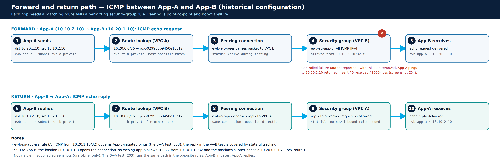

## 6. Step-by-step implementation

The following sequence explains the configuration represented by the project records. It is a reconstruction of the lab workflow, not a claim that these resources are currently deployed.

### Step 1 — Select the AWS Region

The lab was documented in **Asia Pacific (Mumbai), `ap-south-1`**. Keeping resources in one Region makes the console views and resource relationships easier to track.

### Step 2 — Create VPC A and VPC B

Create `ewb-vpc-a` with CIDR `10.10.0.0/16` and `ewb-vpc-b` with CIDR `10.20.0.0/16`. Use distinct, non-overlapping CIDR ranges so that routes to the peer can be unambiguous.

### Step 3 — Create the subnets

Create the public subnet `ewb-a-public` (`10.10.1.0/24`) and private subnet `ewb-a-private` (`10.10.2.0/24`) in VPC A. Create private subnet `ewb-b-private` (`10.20.1.0/24`) in VPC B. Each subnet is associated with the route table that matches its intended role.

### Step 4 — Attach the Internet Gateway

Attach `ewb-igw-a` to VPC A. The Internet Gateway is the VPC component used by the public route for internet-bound traffic. The public subnet's route table must contain a default route (`0.0.0.0/0`) to the Internet Gateway for the bastion's public internet path. The supplied screenshot confirms the gateway attachment; the public route table's Routes tab was not captured, so that route is documented in the inventory as historical configuration rather than directly visible evidence.

### Step 5 — Create and configure the route tables

Use a public route table for the bastion subnet, a private route table for App-A, and a private route table for App-B. Associate each route table with the appropriate subnet. The private route tables need both the local route and a route to the other VPC's CIDR through the peering connection. The route-table screenshots E10 and E11 show the private-side peer routes as Active.

### Step 6 — Launch the EC2 instances

Launch the bastion in `ewb-a-public`, App-A in `ewb-a-private`, and App-B in `ewb-b-private`. The inventory uses the private addresses `10.10.1.10`, `10.10.2.10`, and `10.20.1.10` respectively. App-A and App-B are intended to remain private; the supplied instance screenshots show no public IPv4 address for either application instance.

### Step 7 — Configure security groups

Restrict SSH to the intended administrative path. The bastion accepts SSH from the administrator's public IP address (the specific address is not reproduced in this README). App-A and App-B accept SSH from the bastion's private address, `10.10.1.10/32`, according to the project inventory. ICMP rules permit the ping tests from the opposite application instance. See the security-group table below and the evidence limitations in Section 14.

### Step 8 — Create the VPC peering connection

Create the peering connection between VPC A and VPC B, accept it if required, and verify that its status becomes **Active**. Screenshot E12 shows the connection as Active at capture time. An Active state means the peering connection is established; it does not guarantee that routes and security groups are correct.

### Step 9 — Add routes in both directions

Add `10.20.0.0/16` via the peering connection to the relevant VPC A route tables, and add `10.10.0.0/16` via the peering connection to the VPC B private route table. The private route-table screenshots show the peer routes. The inventory file records the historical route design and its evidence basis: [route-tables.csv](inventory/route-tables.csv).

### Step 10 — Connect through the bastion

SSH to the bastion first, then connect from the bastion to App-A or App-B using their private IP addresses. This keeps the application instances from needing public IP addresses for administration. The terminal screenshots E01–E03 document successful bastion login and onward SSH sessions.

### Step 11 — Run connectivity tests

Test SSH reachability and ICMP reachability in both directions. A ping test checks ICMP connectivity only; it does not prove that every application protocol works. The results table in Section 9 separates results shown in screenshots from outcomes reported without a supplied screenshot.

### Step 12 — Record the evidence and clean up

Capture relevant console and terminal views, record any limitations, and document the cleanup. The project record reports that the instances and network resources were removed after testing. No cleanup screenshots were supplied, so the final deletion state is not independently verified by this repository.

## 7. Route-table design

| Route table | Associated subnet | Destination | Target | Purpose and explanation |
|---|---|---|---|---|
| `ewb-rt-a-public` | `ewb-a-public` | `10.10.0.0/16` | `local` | Routes traffic within VPC A |
| `ewb-rt-a-public` | `ewb-a-public` | `10.20.0.0/16` | VPC peering connection | Allows the bastion subnet to route traffic for VPC B through peering; inventory/brief basis, not directly shown in a Routes-tab screenshot |
| `ewb-rt-a-public` | `ewb-a-public` | `0.0.0.0/0` | Internet Gateway | Default internet route for the public subnet; gateway attachment is shown, but the route itself was not captured in the public Routes tab |
| `ewb-rt-a-private` | `ewb-a-private` | `10.10.0.0/16` | `local` | Routes traffic within VPC A |
| `ewb-rt-a-private` | `ewb-a-private` | `10.20.0.0/16` | VPC peering connection | Forward route from App-A's subnet to VPC B; shown in E10 |
| `ewb-rt-b-private` | `ewb-b-private` | `10.20.0.0/16` | `local` | Routes traffic within VPC B |
| `ewb-rt-b-private` | `ewb-b-private` | `10.10.0.0/16` | VPC peering connection | Return route from App-B's subnet to VPC A; shown in E11 |

**Why both directions matter:** Routing is not automatically symmetric just because the peering connection is Active. If App-A sends a packet to App-B but VPC B has no route back to VPC A, the response may not return. A route table only affects subnets associated with that table, so checking the association is just as important as checking the route entry.

The complete historical route inventory, including route-table IDs and evidence notes, is in [`inventory/route-tables.csv`](inventory/route-tables.csv).

## 8. Security-group design

Security groups are stateful virtual firewalls attached to network interfaces. They control allowed inbound and outbound traffic. The goal of this lab was to allow only the administrative and test traffic needed for the exercise rather than opening the private instances broadly.

| Security group | Direction / protocol | Source | Intended purpose | Evidence status |
|---|---|---|---|---|
| `ewb-sg-bastion` | Inbound SSH / TCP 22 | Administrator public IPv4 `/32` | Allows the administrator to connect to the bastion | Described in project inventory; the complete inbound-rule list was not captured |
| `ewb-sg-app-a` | Inbound SSH / TCP 22 | `10.10.1.10/32` | Allows SSH to App-A from the bastion only | Shown in E13 |
| `ewb-sg-app-a` | Inbound All ICMP - IPv4 | `10.20.1.10/32` | Allows ping initiated by App-B | Shown in E13 |
| `ewb-sg-app-b` | Inbound SSH / TCP 22 | `10.10.1.10/32` | Allows SSH to App-B from the bastion | Inventory/brief basis; full App-B rules screenshot not supplied |
| `ewb-sg-app-b` | Inbound All ICMP - IPv4 | `10.10.2.10/32` | Allows ping initiated by App-A | Inventory/brief basis; rule removal during the failure test was reported, not directly captured |

`/32` identifies one IPv4 address. Using a single-host source such as `10.10.1.10/32` is narrower than allowing the whole subnet. The complete historical security-group inventory is available in [`inventory/security-groups.csv`](inventory/security-groups.csv).

## 9. Connectivity testing and results

| Test | Result recorded | Evidence | Interpretation |
|---|---|---|---|
| SSH to bastion | Successful | E01 | The bastion could be reached by SSH at capture time |
| SSH from bastion to App-A | Successful | E02 | The private App-A host was reachable over the internal path |
| SSH from bastion to App-B | Successful | E03 | The bastion-to-App-B path across VPC peering worked at capture time |
| App-B ping to App-A | 4 transmitted, 4 received, 0% loss | E03 | ICMP worked in this direction at capture time |
| App-A ping to App-B | 4 transmitted, 0 received, 100% loss during controlled failure | E04 | ICMP was failing at that test moment; the project record attributes this to a temporarily removed ICMP rule, but the rule edit itself was not captured |
| App-A ping to App-B after rule restoration | Reported successful on a later retry | No screenshot supplied | Recorded as a reported outcome, not independently demonstrated by the evidence set |
| App-A and App-B public IPv4 status | No public IPv4 address shown | E06–E07 | Supports the design goal of private-only application instances |
| Pre-peering baseline ping | Expected to fail | Not captured | This is an expected baseline, not a screenshot-verified result |
| Cleanup | Reported complete | No cleanup screenshots supplied | Cleanup is documented as reported, not independently verified |

### What the tests show

The successful SSH sessions and App-B-to-App-A ping demonstrate that those specific paths worked at the time captured. The controlled ping failure demonstrates that connectivity was not successful during that test. It does **not**, by itself, prove which configuration change caused the failure; the explanation about removing the ICMP rule comes from the project notes, and the actual rule edit was not captured. A successful ping also does not verify application ports such as HTTP or HTTPS.

See [`docs/test-results.md`](docs/test-results.md) for the concise test log and [`docs/troubleshooting.md`](docs/troubleshooting.md) for checks to perform when peering is Active but traffic fails.

## 10. Screenshot evidence gallery

The images below are embedded so they appear directly in the GitHub README. Each caption describes the main point supported by the screenshot. Images are the supplied captures; they have not been recreated. For the full evidence index and caveats, see [`evidence/README.md`](evidence/README.md).

### Connectivity and SSH

**E01 — SSH login to the bastion.** Shows a successful SSH login and a shell prompt on the bastion host.

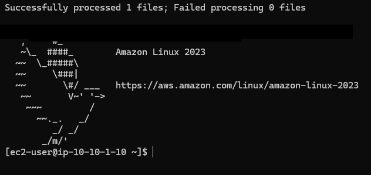

**E02 — SSH from the bastion to App-A.** Shows the onward SSH session to the private App-A instance.

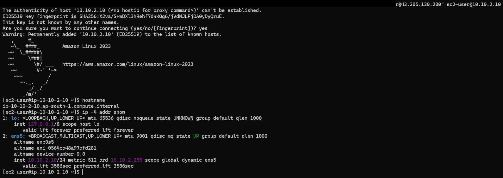

**E03 — SSH to App-B and ping to App-A.** Shows the App-B session and the successful ping result from App-B to App-A.

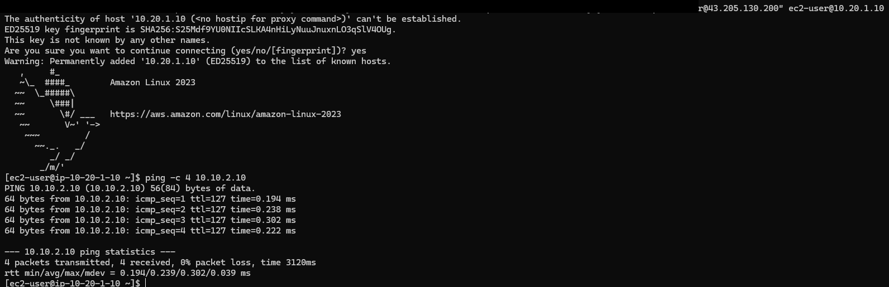

### Controlled failure test

**E04 — App-A ping to App-B with 100% packet loss.** This is the failure output captured during the controlled test. The security-rule change described in the notes was not separately captured.

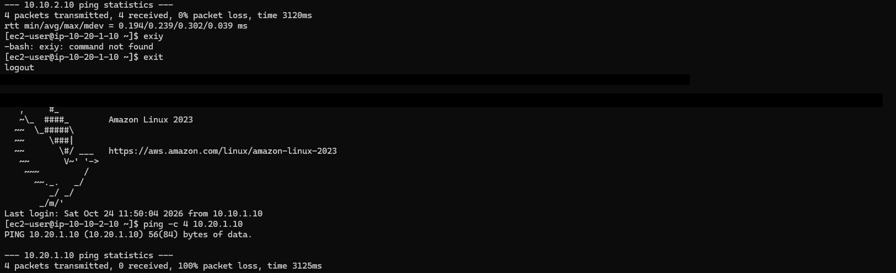

### EC2 instances

**E05 — Bastion instance details.** Shows the bastion's EC2 details, including its private address and console context.

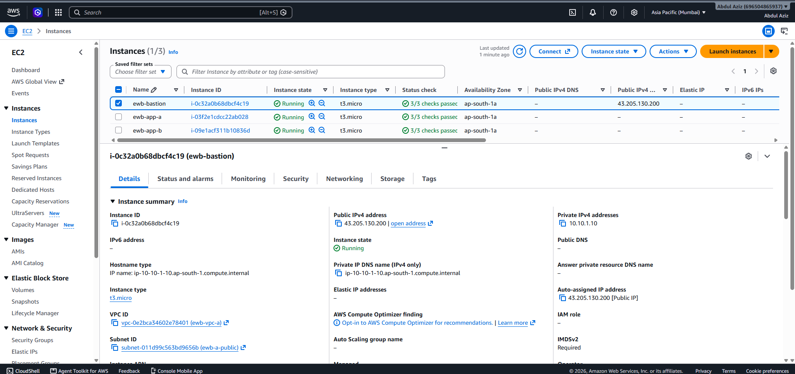

**E06 — App-A instance details.** Supports the private-instance design; no public IPv4 address is shown for App-A.

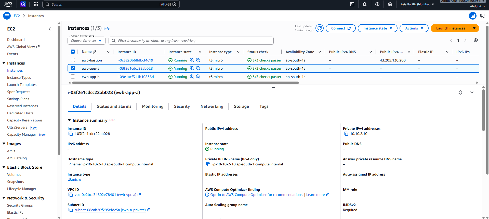

**E07 — App-B instance details.** Supports the private-instance design; no public IPv4 address is shown for App-B.

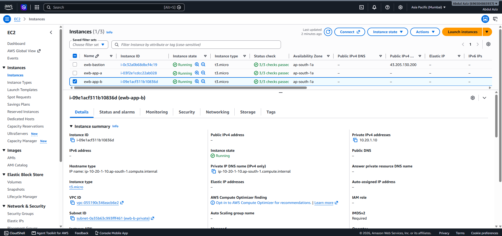

### VPC networking and routes

**E08 — Internet Gateway.** Shows the project Internet Gateway attached to VPC A.

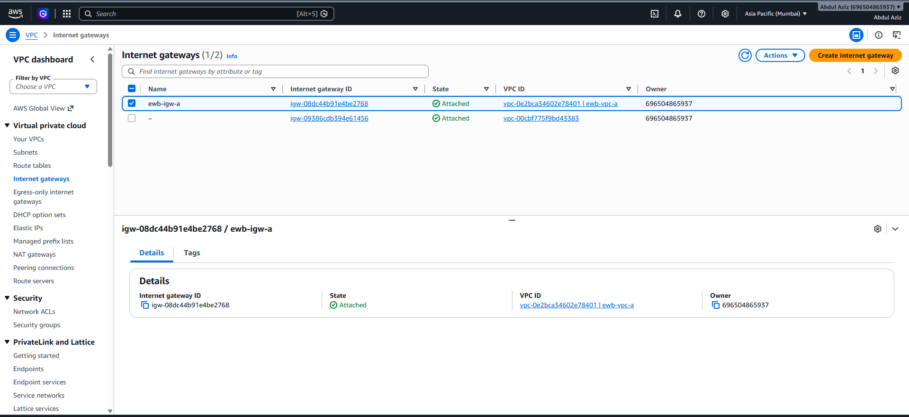

**E09 — Public route-table details and subnet association.** Supports the public route-table association; the Routes tab was not captured.

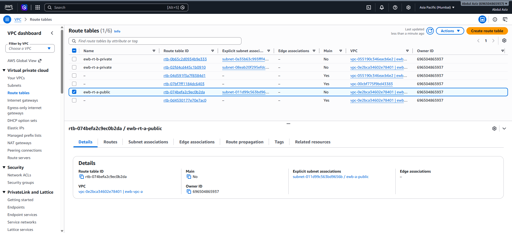

**E10 — VPC A private route table.** Shows the local route and the route to VPC B through the peering connection.

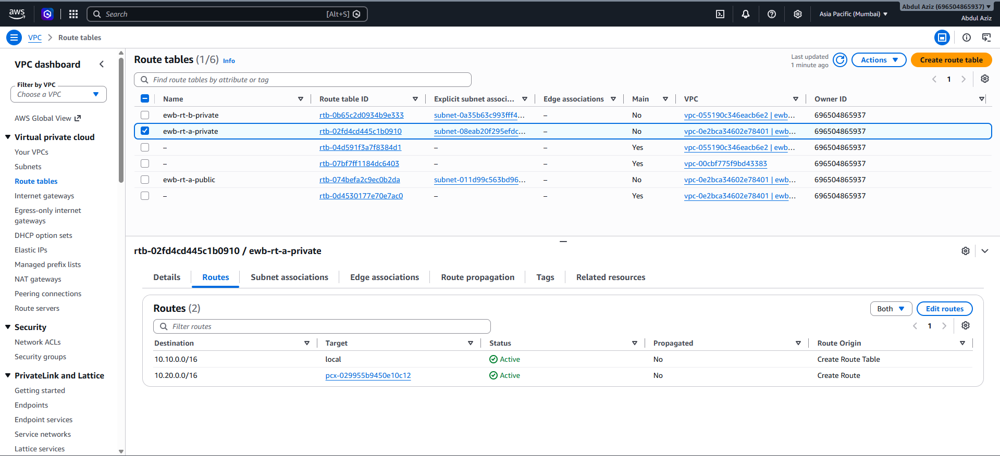

**E11 — VPC B private route table.** Shows the local route and return route to VPC A through the peering connection.

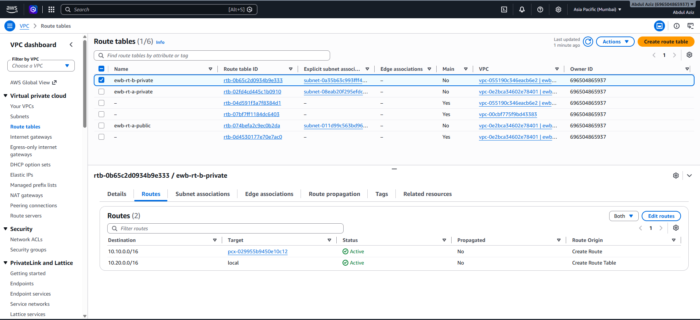

**E12 — VPC peering connection.** Shows the peering connection as Active at the time the screenshot was captured.

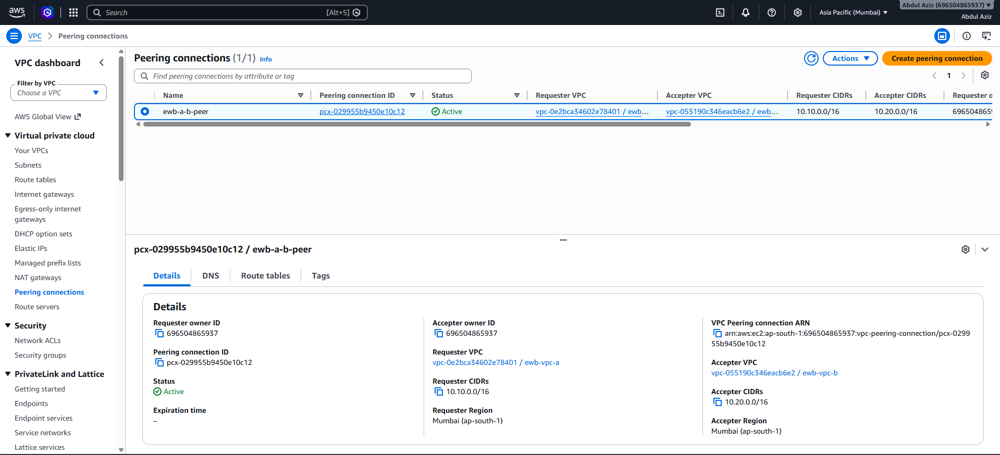

### Security rules

**E13 — App-A inbound security-group rules.** Shows SSH allowed from the bastion's private address and ICMP allowed from App-B's private address.

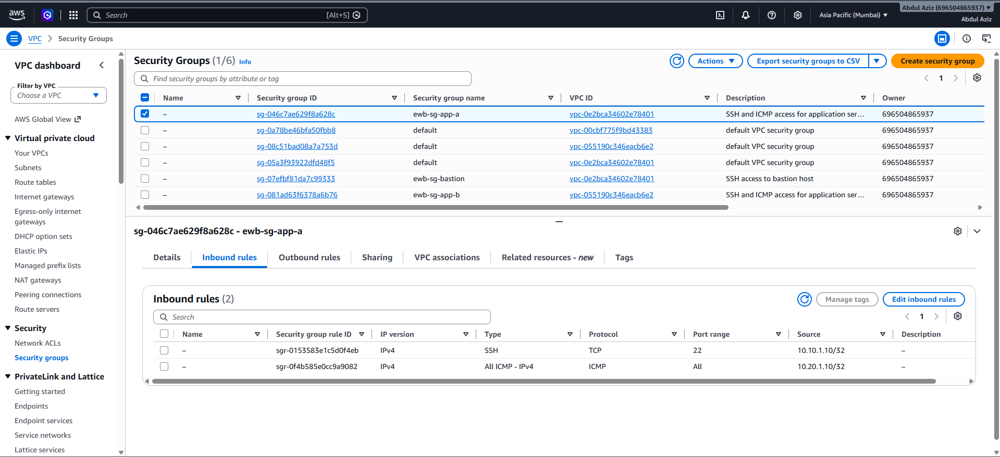

## 11. Troubleshooting and lessons learned

If a VPC peering connection is Active but a ping or SSH attempt fails, check the whole path rather than only the peering status:

1. **Check the target IP.** Confirm the destination is the intended private IPv4 address and that the instance is running.
2. **Check subnet association.** Confirm the subnet is associated with the route table you are inspecting.
3. **Check the forward route.** The source subnet's route table must route the destination VPC CIDR through the peering connection.
4. **Check the return route.** The destination subnet's route table needs a route back to the source VPC CIDR through the peering connection.
5. **Check security groups.** Confirm the destination allows the protocol and source address. For SSH, check TCP port 22; for ping, check ICMP.
6. **Check host-level controls.** Operating-system firewalls and service state can also affect connectivity.
7. **Retest and record the result.** Capture the exact command and output so later readers can distinguish observed results from explanations.

### Lessons learned

- An Active peering connection is necessary but not sufficient; routes and security rules must also be correct.
- Route tables are subnet-specific through their associations.
- Private instances can be administered through a bastion without assigning them public IPv4 addresses.
- Security-group sources should be as narrow as practical for the required traffic.
- A failed ping is a symptom, not a complete diagnosis. The actual configuration change should be captured if it is used to explain the failure.
- Evidence quality matters: clearly label what screenshots show and what the project notes report but do not prove independently.

More detail is in [`docs/lessons-learned.md`](docs/lessons-learned.md) and [`docs/troubleshooting.md`](docs/troubleshooting.md).

## 12. Cleanup and cost-safety notes

After evidence collection, the project record says the EC2 instances were terminated and the subnets, VPC peering connection, Internet Gateway, and VPCs were deleted. **No cleanup screenshots were supplied**, so this repository records cleanup as reported rather than independently verified.

| Resource | Reported final state | Verification note |
|---|---|---|
| `ewb-bastion`, `ewb-app-a`, `ewb-app-b` | Terminated | Reported; no termination screenshot supplied |
| `ewb-a-public`, `ewb-a-private`, `ewb-b-private` | Deleted | Reported; no deletion screenshot supplied |
| `ewb-a-b-peer` / `pcx-029955b9450e10c12` | Deleted | Reported; no deletion screenshot supplied |
| `ewb-igw-a` / `igw-08dc44b91e4be2768` | Deleted | Reported; no deletion screenshot supplied |
| `ewb-vpc-a`, `ewb-vpc-b` | Deleted | Reported; no deletion screenshot supplied |
| Custom route tables and security groups | Reported removed with their VPCs | Individual final states not evidenced |
| EC2 key pair, EBS volumes, Elastic IPs, tags | Final state not established in the project record | Must be checked separately if the account is still available |

### Recommended post-lab verification

If you still have access to the AWS account, do not rely on the report alone. In `ap-south-1`, check EC2 Instances, EBS Volumes, Elastic IPs, Key Pairs, VPCs, Subnets, Route Tables, Internet Gateways, and Peering Connections. Also review AWS Billing and Cost Explorer for any continuing charges. Some resources, such as unattached EBS volumes or allocated Elastic IPs, can remain after an instance is terminated. The project documentation does not establish the current state of the account.

The detailed record is in [`cleanup/cleanup-record.md`](cleanup/cleanup-record.md).

## 13. Repository guide

| Folder or file | Contents | How to use it |
|---|---|---|
| `README.md` | Project overview, architecture, step-by-step workflow, tables, screenshots, results, and cleanup notes | Start here for the full walkthrough |
| `architecture/` | PNG and SVG architecture and traffic-flow diagrams | View the design visually or reuse scalable SVG diagrams |
| `diagrams/` | Mermaid source files | Review or edit the diagrams as text |
| `evidence/` | Supplied terminal and AWS console screenshots | Inspect evidence supporting individual claims |
| `evidence/README.md` | Evidence index E01–E13 and caveats | Match each screenshot to the project claims |
| `inventory/` | CSV inventories of resources, subnets, routes, and security groups | Inspect names, CIDRs, IDs, purpose, and evidence basis |
| `docs/test-results.md` | Connectivity test summary | See outcomes and whether they were screenshot-supported |
| `docs/troubleshooting.md` | Diagnostic sequence for failed connectivity | Use as a networking troubleshooting checklist |
| `docs/requirements-traceability.md` | Evidence-supported observations versus reported outcomes | Understand what is and is not verified |
| `docs/discrepancy-log.md` | Documented gaps and discrepancies | Review evidence limitations before presenting the project |
| `docs/lessons-learned.md` | Lessons from the lab | Review key design and verification takeaways |
| `docs/public-release-checklist.md` | Public-repository review checklist | Review before sharing the repository publicly |
| `cleanup/cleanup-record.md` | Reported resource cleanup | Check which resources were reported removed and which final states remain unknown |
| `report/Abdul_Aziz_EWB_VPC_Peering.pdf` | Project report PDF | Read the formatted report alongside the repository evidence |
| `.gitignore` | Ignore rules | Helps avoid adding unwanted local files |

## 14. Limitations and evidence quality

This repository intentionally separates screenshot-supported facts from statements reported in the project notes. The supplied evidence supports the successful SSH sessions, App-B-to-App-A ping, the captured App-A-to-App-B failure, the peering connection's Active status at capture time, the two private application instances' lack of public IPv4 addresses, the Internet Gateway attachment, the private route-table routes, and App-A's inbound rules.

The supplied evidence does **not** independently show the public route table's Routes tab, all inbound rules for every security group, the exact security-group edit during the controlled failure, the later successful recovery ping, the pre-peering baseline ping, or the cleanup actions. The README and inventory do not claim these missing screenshots exist. Refer to [`docs/requirements-traceability.md`](docs/requirements-traceability.md) and [`docs/discrepancy-log.md`](docs/discrepancy-log.md) for the detailed caveats.

## 15. Security notes

- Do not commit private keys (`.pem` files), passwords, access keys, session tokens, or other credentials.
- Do not copy private SSH keys onto the bastion or application instances; keep them on the administrator's workstation and use the intended SSH workflow.
- Review screenshots for secrets and personal data before making the repository public. Account identifiers and public IP addresses are not passwords, but they may still be operationally sensitive depending on the context.
- Use a narrow administrator source CIDR for bastion SSH instead of opening TCP port 22 to everyone.
- This is a historical learning project, not a production-ready reference architecture. Production deployments require additional design work, monitoring, patching, access controls, and operational review.

---

**Project takeaway:** Reliable VPC peering depends on the combination of non-overlapping CIDRs, correct subnet-to-route-table associations, forward and return routes, and security groups that allow the intended traffic. Clear evidence and honest documentation of limitations are part of a good cloud project, not just supporting material.
